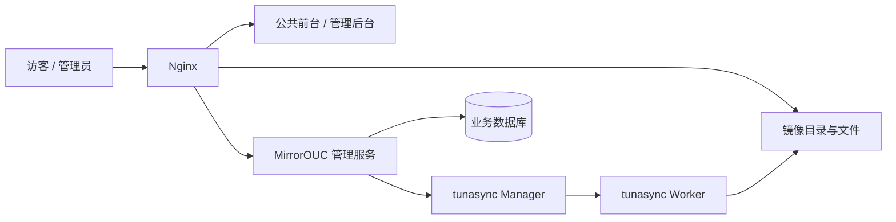

## 已确定的方向

> 实现进度：前台、Go HTTP + SQLite 管理服务及 Vue 管理页面已接入。当前预览部署、使用方式与实际权限边界以 [README.md](README.md) 和 [deploy/README.md](deploy/README.md) 为准；下文保留原始方案。

- 使用 Vue 3、TypeScript 和 Vite 开发前端。
- 使用 vue-i18n，所有界面文案通过语言键引用语言文件。
- 第一版支持简体中文（`zh-CN`）和英文（`en-US`）。
- 支持亮色、暗色以及跟随系统的主题设置。
- 界面配色沿用爱特工作室官网：浅色强调蓝 `#0969DA`，暗色强调蓝 `#58A6FF`；完整色值见 [DESIGN.md](DESIGN.md)。
- 以紧凑、清晰的镜像列表为首页主体，融入中国海洋大学的海洋特色。
- 借鉴机场航班信息屏，在同步状态与时间字段变化时使用向上滚动动效。
- 根目录的 `素材/` 仅用于本地素材整理，不纳入 Git。

## 界面设计

### 布局与视觉

首页采用宽列表、窄侧栏的布局。顶部保留站点标识、主要导航、语言选择和主题切换，主体优先展示搜索与镜像列表。

```text
校徽 / MirrorOUC          使用帮助  公告  同步状态  关于  语言  主题

中国海洋大学软件镜像源
搜索镜像……                         全部 / 发行版 / 软件仓库 / 其他

镜像名称       最近同步 / 下次同步       Size / Status   │ 站点公告
ubuntu         12 分钟前 / —            3.4 TB / 同步中 │ 常用下载
debian         35 分钟前 / 25 分钟后     4.2 TB / 已同步 │ 使用帮助
archlinux      58 分钟前 / 即将开始      1.3 TB / 等待同步│ 相关链接
……                                                      │

中国海洋大学软件镜像源（MirrorOUC）由中国海洋大学爱特工作室承建。
```

上述名称、状态和时间仅用于说明布局，不表示本站实际提供的镜像或运行状态。

亮色主题使用白底、浅灰面板和蓝色重点元素；暗色主题使用 `#0D1117` 背景与 `#161B22` 面板。文字、边框及页脚与爱特工作室官网主题保持一致，品牌通过海大校徽呈现。

主体采用规整表格、细分隔线和克制的圆角。避免大面积渐变、玻璃效果、堆叠装饰卡片、空泛标语及无意义的小字脚注。正文优先使用系统字体，镜像名称与时间数字可使用等宽字体或等宽数字。

移动端同样保留三列及统一轮换机制；帮助、下载和公告入口仍应易于访问。

### 同步动效

- 后两列表头和条目共用一个 5 秒周期，在「最近同步 + Size」与「下次同步 + Status」之间切换。
- 表头每轮向上滚动一次；条目随机滚动 3～6 次，在约一秒内落定至正确值。
- 保持行高、列宽和列表顺序稳定，不因后台状态刷新自动重排列表。
- 同步中的条目使用淡蓝色背景，同步失败的条目使用淡红色背景，文字均沿用普通颜色。
- 支持系统的减少动态效果设置，后台标签页暂停动画和频繁刷新。
- 保证键盘操作、文本选择、屏幕阅读器和英文布局可用，状态不能只依赖颜色表达。

独立的同步状态页面可进一步提供大屏模式，集中展示正在执行和即将执行的任务。首页保持便于查找和点击的列表形式。

## 功能规划

### 公共网站

| 功能 | 计划内容 |
| --- | --- |
| 镜像列表 | 按名称、别名和中文描述搜索，按分类筛选，进入目录或查看帮助 |
| 同步状态 | 展示当前状态、最近成功同步时间、下次计划时间及可获得的镜像大小 |
| 使用帮助 | Markdown 文档、配置示例、代码高亮与复制 |
| 常用下载 | 常见发行版安装镜像和软件安装包的下载入口 |
| 站点公告 | 公告列表、详情、置顶和维护通知 |
| 关于与友链 | 承建信息、联系方式和相关站点链接 |
| 主题与语言 | 独立选择并保存主题、界面语言 |

同步状态与文件可用性分别表达。一次同步失败不直接等同于现有镜像文件不可下载，页面同时保留最近成功同步时间。进度百分比、传输速率等信息，仅在具有可靠数据来源时展示。

### 管理后台

| 模块 | 计划内容 |
| --- | --- |
| 公告与帮助 | Markdown 编辑、预览、草稿、发布、置顶；公告与镜像帮助统一中文内容 |
| 镜像信息 | 名称、分类、描述、帮助关联、公开状态与下载入口 |
| 同步配置 | 上游、同步方式、同步间隔、重试、超时及并发设置 |
| 任务操作 | 手动触发、停止、执行结果、日志和同步历史 |
| 站点设置 | 网站头像／标识、明暗主题 Logo、友链、联系方式和承建信息 |
| 账号与记录 | 管理员登录、内容与运维权限划分、操作记录 |

镜像是否公开展示与同步任务是否启用分别管理。Markdown 渲染应过滤不安全内容，公开接口只返回适合对外展示的信息。

## 国际化约定

### 界面文案

公开网站与管理后台统一使用 vue-i18n。导航、按钮、标题、占位提示、工具提示、校验错误、确认弹窗、空状态、加载状态、无障碍标签及页面标题，都必须从语言文件读取。

使用稳定、语义化的语言键，例如：

```vue
<script setup lang="ts">
import { useI18n } from 'vue-i18n'

const { t } = useI18n()
</script>

<template>
  <button>{{ t('common.save') }}</button>
  <span>{{ t('mirrors.status.syncing') }}</span>
</template>
```

语言文件按语言和功能模块划分，以下为计划结构：

```text
src/locales/
├── index.ts
├── zh-CN/
│   ├── common.ts
│   ├── site.ts
│   ├── mirrors.ts
│   ├── announcements.ts
│   └── admin.ts
└── en-US/
    ├── common.ts
    ├── site.ts
    ├── mirrors.ts
    ├── announcements.ts
    └── admin.ts
```

例如，`zh-CN/mirrors.ts` 导出 `mirrors` 命名空间对应的内容：

```ts
export default {
  status: {
    syncing: '同步中',
    success: '已同步',
  },
  nextSync: '下次同步：{time}',
}
```

对应的 `en-US/mirrors.ts`：

```ts
export default {
  status: {
    syncing: 'Syncing',
    success: 'Synced',
  },
  nextSync: 'Next sync: {time}',
}
```

开发时遵循以下规则：

- 组件中不硬编码可翻译文案，也不通过拼接词语生成句子；使用完整句子的参数插值。
- 使用 TypeScript 约束语言键，并检查各语言的键、插值参数是否一致。
- 使用 vue-i18n 和 `Intl` 格式化日期、相对时间、数字及复数，不手动拼接“分钟前”等单位。
- 后端返回稳定的状态码、错误码、参数和时间戳，前端映射为本地化文案。
- 不直接将后端原始错误文本展示为公共页面提示；运维日志在管理后台单独查看。
- 软件名称、仓库标识、网址、文件名、命令和用户输入保持原值。
- 滚动组件应适应不同语言的文字长度，并在减少动态效果模式下直接更新文本。

### 语言选择与回退

语言选择顺序为：用户保存的选择 → 匹配浏览器语言 → 简体中文。浏览器区域语言需映射到支持的语言，例如 `en-GB` 匹配 `en-US`。

缺少界面译文时回退至简体中文，同时在开发和检查流程中暴露缺失项。切换语言后同步更新文档的 `lang` 属性、页面标题和相关无障碍标签。

语言偏好与主题偏好独立保存。语言与时区也分别处理，切换语言不应改变时间戳所代表的实际时刻；需要展示固定调度时间时明确标注时区。

### 动态内容

公告标题、正文和镜像帮助文档只维护一份中文，所有界面语言展示相同内容，正文节点标记 `lang="zh-CN"`。镜像介绍和可编辑站点文案仍按语言保存于内容数据中，不写入前端语言包。

## 建议技术架构

Vue、TypeScript、Vite 和 vue-i18n 已确定；以下后台组件与部署方式作为当前推荐方案，实施时结合服务器现状确认。

| 部分 | 技术建议 | 用途 |
| --- | --- | --- |
| 公共网站 | Vue 3 + TypeScript + Vite | 镜像列表、内容页面和局部动效 |
| 管理后台 | Vue 3 + Naive UI | 表格、配置表单、编辑与管理操作 |
| 国际化 | vue-i18n + Intl | 文案、数字、日期和相对时间 |
| 管理服务 | Go + Gin | 内容管理、权限、tunasync 适配和配置发布 |
| 业务存储 | SQLite | 公告、帮助、站点配置、账号和操作记录 |
| 文件与入口服务 | Nginx | 静态前端、镜像文件、目录浏览和 API 反向代理 |
| 同步引擎 | tunasync Manager / Worker | 镜像同步、任务控制和状态上报 |
| 进程管理 | systemd | 服务启动、日志及重启管理 |



镜像文件由 Nginx 直接提供，支持包管理器访问与断点续传。网站路由、业务 API 和镜像路径需明确划分，前端路由回退不能拦截镜像文件请求或将不存在的文件返回为首页。

管理服务使用独立业务数据库，不直接修改 tunasync 的内部数据库。tunasync 管理接口仅通过本机或内部网络访问，由管理服务完成鉴权、权限检查和操作记录。

应用使用专用低权限账号运行。需要写入同步配置时，仅授权指定配置目录和必要操作；SSH 密钥、访问凭据和私有部署信息不写入仓库。

## tunasync 对接

### 状态与任务控制

上游当前提供 `/jobs`、Worker 查询和 `/cmd` 等接口，并支持配置重载。实施前需要核对服务器实际安装版本，建立统一适配层，将上游状态转换为前端使用的数据结构。

管理服务集中采集并缓存同步状态，前端初期采用约 15 秒一次的轮询。采集失败时保留最近一次有效数据并显示更新时间，避免将连接故障误显示为所有镜像同步失败。

任务操作需要区分“指令已提交”与“任务实际执行结果”，通过后续状态确认执行情况。日志查看与长期同步历史需要另外采集和保存，并设置保留期限。

### 配置发布

可视化配置编辑通过以下流程应用到 Worker：

```text
编辑草稿 → 校验 → 查看差异 → 保存版本 → 应用并重载 → 检查结果
                                                        ↓
                                                 失败时支持回滚
```

配置应区分草稿、已应用版本和实际运行结果。发布时采用备份与原子替换，并检测文件是否已被其他操作修改，防止覆盖服务器上的人工变更。具体配置写入与重载方式需结合现有部署确认。

### 调度边界

tunasync 的原生 `interval` 表示同步完成后等待指定分钟数再执行，不等同于固定时刻调度。

首版建议优先支持原生间隔调度。如果需要“每天凌晨两点”或“仅夜间同步”，需要补充独立的调度逻辑，处理时区、并发、重复触发和失败重试，并确保每个任务只有一个调度来源。

固定时刻调度是否进入首版，尚待确定。

## 开发计划

### 第一阶段：基础工程与界面原型

- 初始化 Vue、TypeScript、Vite、路由和国际化结构。
- 建立亮暗主题变量及基础组件。
- 完成首页、搜索筛选、移动端布局和同步信息滚动动效。
- 使用明确标识的演示数据覆盖正常、同步中、失败、暂停和未知状态。
- 检查中英文布局、键盘操作和减少动态效果模式。

### 第二阶段：真实数据与内容管理

- 核对服务器环境、tunasync 版本和现有配置。
- 建立管理服务与状态适配层，接入真实镜像列表。
- 完成公告、帮助、常用下载和站点设置。
- 完成后台登录、内容编辑；公告和镜像帮助统一中文，其他站点文案按需支持多语言。
- 配置镜像文件服务、网站路由与部署流程。

### 第三阶段：运维管理

- 完成可视化同步配置、配置版本与发布流程。
- 完成任务操作、结果确认、日志及同步历史。
- 实现确认纳入范围的调度策略。
- 验证配置错误、重载失败、状态断连及回滚场景。

## 验证重点

- 切换语言后，公开网站与后台均无遗漏的界面文案，语言键和参数完整。
- 长英文、长镜像名、窄屏以及亮暗主题下均能正常阅读和操作。
- 状态刷新不打断搜索、点击和键盘焦点，减少动态效果设置生效。
- 状态过期、无数据和同步失败能够正确区分。
- Markdown 内容渲染、管理权限与配置发布经过针对性验证。
- 镜像文件链接、错误码和断点续传行为符合实际下载需求。

## 仓库与素材

根目录 `素材/` 已通过 `.gitignore` 忽略，原始素材不提交到 Git。实际使用的发布资源应按需整理到应用资源目录，避免整体复制原始素材文件夹。

前端预览已实现，依赖版本、开发命令、构建及校验方式见 [README.md](README.md)。当前数据均为演示数据；真实接口、服务配置和部署文档将在后端接入阶段补充。

## 待明确事项

- 首版是否需要固定时刻或指定时间窗口的同步调度。
- 服务器现有服务、目录结构、tunasync 版本及配置管理方式。
- 正式访问域名、可用线路和首批镜像范围。
- 网站标识、联系方式、友链及首批帮助文档内容。

## 参考资料

- [tunasync 项目](https://github.com/tuna/tunasync)
- [tunasync Worker 配置说明](https://github.com/tuna/tunasync/blob/master/docs/zh_CN/configs.md)
- [tunasync 配置重载与操作说明](https://github.com/tuna/tunasync/blob/master/docs/zh_CN/tips.md)
- [吉林大学开源镜像站](https://mirrors.jlu.edu.cn/)
- [清华大学开源软件镜像站](https://mirrors.tuna.tsinghua.edu.cn/)
- [中国科学技术大学开源软件镜像](https://mirrors.ustc.edu.cn/)

参考站用于研究功能和信息布局，MirrorOUC 的视觉与交互围绕中国海洋大学品牌单独设计。
